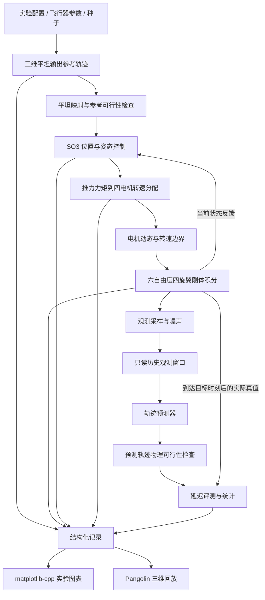

# UAV Predict Sim：三维四旋翼轨迹预测数值仿真

> **已按审查架构实现首个刚体仿真版本。** 包括六自由度刚体、电机动态、平坦映射、SO(3) 前馈控制、三维参考轨迹、位置观测、CV/CA 预测、延迟评测和日志回放。下文保留完整架构；尚未实现的约束优化预测器等内容会明确标注。

`last/` 和 `ego-planner/` 均不参与构建、测试或运行，可以删除。必要的上游回归副本和许可证已经保存在 `tests/upstream/`、`third_party/` 及根 `LICENSE`，不是运行时从参考目录加载。

本项目研究三维运动四旋翼的未来轨迹预测。以 EGO-Planner 的 `uav_simulator`，尤其是 `so3_control` 和 `so3_quadrotor_simulator` 为主要学习和移植来源，建立 **平坦输出参考轨迹 → SO(3) 跟踪控制 → 电机分配 → 四旋翼刚体动力学 → 观测 → 轨迹预测 → 评测** 的独立 C++ 仿真系统。

无人机的横向加速度必须通过机体倾斜、推力和转动响应产生。三维位置、机体姿态、角速度与电机转速均参与真实状态演化。matplotlib-cpp 负责实验图表，Pangolin 负责真实机体姿态和三维轨迹回放，整个项目无 ROS。

## 快速运行

核心依赖：C++17、CMake 3.16+、Eigen 3.3+、yaml-cpp。默认开启测试，上游回归测试还需系统 Boost 头文件；不运行测试时可设置 `-DBUILD_TESTING=OFF`。本机已验证 GCC 11.4、CMake 3.22.1、Eigen 3.4.0、yaml-cpp 0.7.0 和 Boost 1.74。

```bash
cmake -S . -B build -DCMAKE_BUILD_TYPE=Release
cmake --build build -j2
ctest --test-dir build --output-on-failure

# 三维螺旋：位置、姿态和转速由刚体动力学积分生成
./build/uav_sim --config configs/helix.yaml --output outputs/helix-001

# 三维空间八字，含独立的高度变化和航向变化
./build/uav_sim --config configs/eight.yaml --output outputs/eight-001
```

输出目录必须是新目录。`--help` 查看参数；`--scene hover|vertical|helix|eight` 可在加载配置后覆盖场景。完整解析参数保存在运行目录 `config.yaml`，可用于复现。控制器默认读取理想当前状态，预测器只读取带噪历史位置。

可选图表依赖 Python 开发库、NumPy、Matplotlib；三维回放需系统安装的 Pangolin/OpenGL。本机已验证 Python 3.10.12、NumPy 1.21.5、Matplotlib 3.5.1；Pangolin 已编译和链接，当前会话无显示环境，窗口交互尚待桌面验证。

```bash
cmake -S . -B build-visual -DCMAKE_BUILD_TYPE=Release \
  -DUAV_ENABLE_PLOTTING=ON -DUAV_ENABLE_VIEWER=ON \
  -DPython3_EXECUTABLE=/usr/bin/python3
cmake --build build-visual -j2
ctest --test-dir build-visual --output-on-failure

# Agg 后端，不需要显示器
MPLCONFIGDIR=/tmp/uav-predict-mpl \
  ./build-visual/uav_sim --config configs/eight.yaml --output outputs/eight-plot-001 --plot

# 读取已有日志，重新绘图，不重跑仿真
MPLCONFIGDIR=/tmp/uav-predict-mpl \
  ./build-visual/uav_sim --replay outputs/eight-plot-001 --plot

# 在有图形显示的桌面终端回放
./build-visual/uav_sim --replay outputs/eight-plot-001 --view
```

两个显示相关选项默认关闭，可独立开启。Pangolin 不在默认路径时设置 `-DPangolin_DIR=/path/to/lib/cmake/Pangolin`。`--replay` 不允许与场景、配置或输出覆盖参数组合；回放只读数值日志，`--plot` 会更新图表文件。

运行目录包含 `config.yaml`、`metadata.txt`、`reference.csv`、`state.csv`、`control.csv`、`observation.csv`、`prediction.csv`、`metrics.csv`、`lead_metrics.csv`、`events.csv`。绘图生成 `trajectory3d.png`、`tracking.png`、`dynamics.png`、`prediction_errors.png`。末尾不完整预测保留在日志中，但 ADE/FDE 留空且不参与完整时域统计；CV/CA 的高阶物理约束标为不适用。

当前实际的平坦可行性检查覆盖参考轨迹的每个积分 tick；不声称连续时间全局保证。含电机滞后的实际执行能力通过前向积分、饱和日志和跟踪误差观察。约束优化 `FlatnessPredictor` 尚未实现；CV/CA 仅作为无约束对照，不冒充物理可行预测器。

实验元信息中的 `revision_at_build` 是 CMake 配置时确定、编译进二进制的版本；提交后重新配置和构建可刷新。相同二进制与标准库下的数值日志可复现，耗时不要求一致。详细验收依据见 [验证记录](docs/validation.md)，来源与许可见 [第三方记录](third_party/README.md)。

## 1. 本轮需要审查的架构选择

| 项目 | 建议设计 |
| --- | --- |
| 仿真真值 | 六自由度刚体 + 四电机一阶响应，由控制输入积分生成 |
| 平坦模型 | 以三维位置和航向为平坦输出，显式使用速度、加速度、jerk、snap 与航向导数 |
| 上游复用 | 学习并抽离动力学、SO(3) 外环、姿态内环与电机混控，保留来源和参数约定 |
| 控制器 | 先建立上游行为对照，再补齐期望角速度、角加速度前馈，作为正式实验控制器 |
| 默认工况 | 无阻力、无外扰的标称模型；电机滞后默认保留，阻力和外扰单独启用 |
| 预测任务 | 默认只看带时间戳的历史三维位置；预测飞行器的实际未来位置 |
| 方法组织 | CV/CA 作为无约束对照；平坦性约束预测器作为后续研究接口与实现目标 |
| 图表/显示 | matplotlib-cpp 生成三维与分轴统计图；Pangolin 显示机体、参考、实际与预测轨迹 |
| 运行组织 | 一个确定性仿真主循环；记录与回放分开，显示不驱动动力学 |
| 当前交付 | 刚体仿真、控制、因果基线预测、图表与姿态回放；约束优化预测器待后续实现 |

## 2. 本地上游代码：学习对象与移植边界

学习时的本地参考目录为 `ego-planner/`（可删除），上游为 [ZJU-FAST-Lab/ego-planner](https://github.com/ZJU-FAST-Lab/ego-planner)，固定参考版本：

```text
bfda51284c8c1b476043255a8145ef925a3778a5
```

### 2.1 已阅读的核心文件

| 本地文件 | 已确认行为 | 新项目中的归属 |
| --- | --- | --- |
| [SO3Control.cpp 回归副本](tests/upstream/SO3Control.cpp) | 位置/速度反馈、加速度前馈及附加加速度误差项；由合力和航向构造期望姿态 | `src/control/so3.cpp` |
| 上游 `so3_control_nodelet.cpp` | 订阅位置命令和状态，发布合力、姿态与增益 | 仅提取输入输出语义，ROS 包装由实验调度器替代 |
| 上游 `quadrotor_simulator_so3.cpp` 的 `getControl()` | 合力向当前机体推力轴投影，SO(3) 姿态反馈、角速度阻尼、陀螺补偿和转速分配 | `src/control/so3.cpp` 与 `src/dynamics/quadrotor.cpp` |
| [Quadrotor.h 回归副本](tests/upstream/include/quadrotor_simulator/Quadrotor.h) | 状态包括 `x, v, R, omega, motor_rpm`，输入为四电机期望 RPM | `dynamics/quadrotor` 的接口参考 |
| [Quadrotor.cpp 回归副本](tests/upstream/Quadrotor.cpp) | 推力/力矩、电机滞后、重力、阻力、外力/外力矩和数值积分 | `src/dynamics/quadrotor.cpp` |

### 2.2 需要显式处理的上游细节

这些是本地代码的实际行为，不能仅依据注释推断：

- `SO3Control::calculateControl()` 接收 `des_yaw_dot`，但函数体没有使用它；`getControl()` 中角速度误差直接取当前 `omega`。正式版本需要加入动态期望姿态的角速度和角加速度前馈。
- 外环注释写“45 degree”，实现却设置 `theta = π/2`。新版本把最大倾角作为唯一配置参数，拒绝沿用矛盾的注释和隐式限幅。
- 动力学中存在速度平方阻力。第一组标称实验关闭它，确保与下面的理想平坦模型一致；启用时作为明确的模型失配实验。
- 构造函数初始化了外力，但未显式初始化 `external_moment_`；ROS 包装运行时又会设置它。抽离后所有状态、输入、扰动都必须在构造或 `reset()` 时确定初始化。
- 上游有 NaN 导数清零、状态回退及地板位置修正。新版本将非有限值、接地与约束失效记录为明确事件，基准实验不以静默修正掩盖失效。
- 上游用矩阵状态及 LLT 修正旋转矩阵；新版本采用单位四元数积分并归一化，转换为 `R` 参与计算，单独验证旋转群误差与步长收敛。
- 上游系数的转速单位是 **RPM**。不能直接改成 rad/s 后继续使用相同 `kf/km`。

第一阶段保留上游控制公式的对照实现，建立确定输入和初值下的单步/短时回归。之后把数值修正、显式配置、前馈扩展分别提交；上游兼容结果与正式控制器结果分别标记。

## 3. 状态、坐标系和四旋翼动力学

### 3.1 统一约定

- 世界系 `W`：右手系，`z` 轴向上，重力为 `-g e3`，`e3 = [0, 0, 1]ᵀ`。
- 机体系 `B`：右手系，`x` 向前、`y` 向左、`z` 沿正推力方向。
- `R = R_WB`：从机体系转到世界系；`v`、`a`、外力在世界系，`ω`、`τ`、外力矩在机体系。
- 内部姿态为单位四元数 `q_WB`，日志显式写 `qw,qx,qy,qz`；Eigen 构造参数与 `coeffs()` 顺序的差异在序列化边界处理。
- 时间 s，位置 m，质量 kg，角速度 rad/s，力 N，力矩 N·m；电机转速单独标为 RPM。
- 航向命令 `ψ` 沿用上游的水平参考方向参数；倾斜时不把它与实际 ZYX Euler yaw 强行等同。实际 Euler yaw 单独记录。

完整状态与输入：

```text
QuadrotorState = {t, p_W, v_W, q_WB, omega_B, rotor_rpm[4]}
MotorCommand   = {rpm_command[4]}
Disturbance    = {force_W, torque_B}
```

### 3.2 运动方程

记 `hat(ω) x = ω × x`，总推力为 `f ≥ 0`，机体力矩为 `τ`，转子转速为 `n_i`：

```math
\dot p = v,\qquad
m\dot v = -mg e_3 + f R e_3 + F_{ext} + F_{drag}
```

```math
\dot R = R\widehat\omega,\qquad
J\dot\omega = \tau - \omega\times(J\omega) + \tau_{ext}
```

```math
f = k_f\sum_{i=1}^4 n_i^2,\qquad
\dot n_i = \frac{n_{i,cmd}-n_i}{\tau_m}
```

机体姿态决定推力方向，转动力学决定姿态如何改变，电机滞后决定推力/力矩如何建立。参考位置和预测位置均不能直接赋值给真值状态。

默认数值方案为固定步长 RK4，四元数采用 `q̇ = 1/2 q ⊗ [0,ω_B]`，在积分阶段构造旋转时使用规范化姿态，完整步后归一化，并记录归一化前误差。积分器与模型方程分离；验收时以步长减半及独立短时积分结果检查数值误差。

### 3.3 电机编号与混控

沿用上游 **“+”构型**，不在显示中画成另一种旋翼布局：1 前、2 后、3 左、4 右。力矩符号以如下矩阵为准，旋转动画也据此标注：

```math
\begin{bmatrix}f\\\tau_x\\\tau_y\\\tau_z\end{bmatrix}
=
\begin{bmatrix}
k_f&k_f&k_f&k_f\\
0&0&lk_f&-lk_f\\
-lk_f&lk_f&0&0\\
k_m&k_m&-k_m&-k_m
\end{bmatrix}
\begin{bmatrix}n_1^2\\n_2^2\\n_3^2\\n_4^2\end{bmatrix}
= A n^2
```

分配器先求 `n² = A⁻¹[f_cmd, τ_cmd]ᵀ`。原始解、受 RPM 边界约束的命令及实际转速分别保留；负平方转速和越界解必须标记为分配不可行。执行器执行物理限幅，不能把限幅后的合力冒充原始控制需求。日志记录 `A n_actual²` 与需求的差值。

初始参数取自本地 `Quadrotor.cpp`，作为统一 `VehicleParams` 的候选默认值：

| 参数 | 上游值 |
| --- | --- |
| `m`, `g` | 0.98 kg，9.81 m/s² |
| `J` | diag(2.64e-3, 2.64e-3, 4.96e-3) kg·m² |
| `l`, 桨半径 | 0.26 m，0.062 m |
| `kf` | 8.98132e-9 N/RPM² |
| `km` | `0.07 × (3 × 0.062) × kf` N·m/RPM² |
| `τm` | 1/30 s |
| 飞行态 RPM 范围 | 1200–35000 RPM |

控制器、平坦映射、仿真器和约束检查器共享这一份参数，避免质量或转速单位不一致。初始状态采用可行悬停或参考轨迹的平坦映射状态，并初始化相应转速；起飞过程另设场景，不以零转速启动伪装成平衡悬停。

## 4. 微分平坦模型与可行性约束

### 4.1 平坦输出和导数接口

标称无阻力、无外扰、以总推力和力矩为输入的刚体模型，采用局部平坦输出：

```math
y(t)=[p_x(t),p_y(t),p_z(t),\psi(t)]^T
```

`FlatOutputSample` 提供 `p, v, a, j, s, ψ, ψ_dot, ψ_ddot`，其中 `j = p⁽³⁾`，`s = p⁽⁴⁾`。轨迹发生器直接解析求导，避免对带噪位置逐次差分来制造高阶导数。

平坦性意味着在非奇异区间内可以从这些输出及有限阶导数重建状态与所需输入，**不意味着任意光滑三维曲线都满足电机、倾角或控制带宽约束**。基本依据见 Mellinger 的[轨迹生成与控制论文](https://robo.fish/wiki/images/d/dd/Trajectory_Generation_and_Control_for_Quadrotors_Daniel_Mellinger.pdf)。

### 4.2 平坦输出到推力、姿态、角速度和力矩

在上述符号下：

```math
h=a+ge_3,\quad f_{ff}=m\|h\|,\quad b_3=\frac{h}{\|h\|}
```

沿用上游的航向构造，令 `c1 = [cosψ, sinψ, 0]ᵀ`：

```math
b_2=\frac{b_3\times c_1}{\|b_3\times c_1\|},\qquad
b_1=b_2\times b_3,\qquad R_{ff}=[b_1\ b_2\ b_3]
```

由 `j` 和 `ψ_dot` 对姿态构造求导，由 `s` 和 `ψ_ddot` 求二阶导，得到：

```math
\omega_{ff}=\operatorname{vee}(R_{ff}^T\dot R_{ff}),\qquad
\dot\omega_{ff}=\operatorname{vee}(R_{ff}^T\ddot R_{ff}-\widehat\omega_{ff}^{\,2})
```

```math
\tau_{ff}=J\dot\omega_{ff}+\omega_{ff}\times(J\omega_{ff})
```

`FlatnessMap` 为无状态数学模块，输出 `FlatnessState = {R_ff, f_ff, omega_ff, alpha_ff, torque_ff}` 和有效性状态。状态、控制参考和约束检查使用同一映射实现。

### 4.3 需要检查的约束

| 类别 | 检查内容 | 处理 |
| --- | --- | --- |
| 推力方向一致性 | `m(a + g e3) = f R e3` | 记录重建残差，验证符号与坐标系 |
| 非奇异性 | `||a + g e3|| > epsilon_f`；`||b3 × c1|| > epsilon_heading` | 不允许对零向量归一化，返回无效原因 |
| 姿态 | `RᵀR ≈ I`，`det(R) ≈ 1`，单位四元数 | 超限报告数值失效 |
| 倾角 | `b3 · e3 ≥ cos(theta_max)` | 明确正飞区间，初期不研究翻转或自由落体 |
| 输入 | 正推力范围、`A⁻¹[f,τ]` 的各 RPM² 上下界 | 单独验证，不能只验证总推力 |
| 转动 | `||omega||` 和角加速度边界 | 由 jerk、snap、航向导数映射后检查 |
| 运动包线 | 速度、加速度、jerk、snap 的配置上限 | 作为实验运动范围，不能替代执行器检查 |
| 连续性 | 位置至少 C4、航向至少 C2 | 保证基准轨迹的力矩参考连续 |
| 实际执行 | 电机动态、饱和率、需求/实际 wrench 残差、跟踪误差 | 使用刚体前向仿真验证 |

`theta_max`、运动包线和角速度上限属于实验配置，不从上游含糊注释中猜测。候选轨迹先做逐时刻可行性检查，正式运行仍持续监测约束。

**电机动态的边界：** 上述重建首先针对总推力/力矩输入的理想刚体。保留电机滞后后，不能声称仅凭位置到 snap 就完成了整个扩展系统的精确逆动力学。若进一步计算 `n_cmd = n + τm n_dot`，还需更高阶导数（一般涉及位置五阶导及航向三阶导）。第一阶段通过实际电机前向仿真检验可跟踪性，扩展电机逆映射放在后续阶段。

**连续时间保证的边界：** 离散采样全部通过只标记为“采样检查通过”。多项式约束若未通过极值搜索或区间界验证，不标记为“全时域保证”。对失败轨迹允许显式延长时间后重新生成、重新检查，不能逐点裁剪加速度后继续使用原来的 jerk/snap。

## 5. SO(3) 跟踪控制架构

### 5.1 位置外环

保留上游“合力 + 航向 → 期望姿态”的结构，正式版本的基础外环为：

```math
F_c=m(a_d+ge_3)+K_p(p_d-p)+K_v(v_d-v)
```

`Kp`、`Kv` 明确是力反馈增益。上游额外的加速度误差项先放入兼容控制器，正式标称版本默认关闭，避免把经验项当成平坦模型必要组成。

由 `F_c` 和期望航向生成 `R_c`；推力命令为 `f_c = F_c · R e3`。姿态、推力通过实际执行器实现，外环不直接修改动力学加速度。

### 5.2 姿态内环

使用几何姿态误差与角速度误差：

```math
e_R=\tfrac12\operatorname{vee}(R_c^TR-R^TR_c),\qquad
e_\omega=\omega-R^TR_c\omega_c
```

```math
\tau_c=-K_R e_R-K_\omega e_\omega+\omega\times J\omega
-J\left(\widehat\omega R^TR_c\omega_c-R^TR_c\dot\omega_c\right)
```

控制结构参考 [Lee、Leok 与 McClamroch 的 SO(3)/SE(3) 几何控制工作](https://arxiv.org/abs/1003.2005)，具体推力方向按本项目向上推力约定实现。正式控制器需要完整验证，不把理论结论直接延伸到存在饱和和电机滞后的离散系统。

`omega_c` 和 `alpha_c` 必须由 **同一个 `R_c`** 的时间导数得到。不能由反馈合力计算 `R_c`，却把纯参考轨迹的 `omega_ff` 直接当成它的精确导数。建议用解析参考导数与当前模型状态导数计算：

```text
F_c_dot  = m j_d + Kp(v_d - v) + Kv(a_d - a)
F_c_ddot = m s_d + Kp(a_d - a) + Kv(j_d - j_actual)
```

其中 `a`、`j_actual` 由当前动力学和电机状态计算，使用当前时刻及已知输入，不访问未来真值。标称实验中控制器可读取完整当前状态，这是理想状态反馈；预测器的观测权限另行限制。启用噪声控制反馈或扰动时，导数估计与控制带宽作为独立扩展实验。

实际接口为 `control(state, flat_reference, held_command, quad, gains, ...) -> ControlOutput`，再交给 `allocate()` 和 `Quadrotor::step()`。通过更新前持有的电机命令求当前 jerk，避免与新控制命令形成代数环。正式模式不保留未经说明的外部 yaw 覆写，也不使用欧拉角积分姿态。

## 6. 总体模块与数据流



建议静态库依赖方向为 `math/types → flatness/dynamics → control/actuation → simulation`；`prediction` 只依赖历史观测类型及可选的标称模型，`evaluation` 消费预测和对齐真值。`io`、`plotting`、`visualization` 位于外层，核心库不包含它们的头文件。所有模块由 `ExperimentRunner` 组合，通过普通 C++ 对象传递，不引入消息总线或 ROS 式节点系统。

| 模块 | 输入 → 输出 | 主要职责 |
| --- | --- | --- |
| `trajectory` | 场景参数、t → `FlatOutputSample` | 三维解析轨迹与分段多项式，提供一致的解析导数 |
| `flatness` | 平坦样本、模型参数 → 姿态/输入参考、约束状态 | 平坦重建、奇异性检测、可行性检查 |
| `control` | 当前反馈、当前参考 → `WrenchCommand` | 位置和 SO(3) 姿态控制 |
| `actuation` | wrench、RPM 状态 → RPM 命令、实际 wrench | 分配、饱和与电机响应 |
| `dynamics` | 当前刚体状态、实际 wrench、扰动 → 状态导数 | 动力学方程、积分与状态有效性 |
| `observation` | 当前真值、独立噪声流 → `Observation` | 按传感频率采样，限制可见字段 |
| `prediction` | `HistoryView`、预测网格 → `PredictionResult` | 可替换的预测算法和失败状态 |
| `evaluation` | 已完成的预测、对应实际真值 → 误差统计 | 因果时间对齐、精度、可行率和耗时 |
| `simulation` | 完整配置 → 实验运行 | 时钟、多频调度、事件与终止策略 |
| `io/presentation` | 日志或不可变快照 → 文件、图表、窗口 | 可复现记录、离线分析和回放 |

## 7. 轨迹预测任务及物理约束的作用

### 7.1 默认任务

在时刻 `t0`，给定过去 `T_hist` 内带噪位置 `{t_i, p_obs_i}`，预测 `t0 + Δt ... t0 + T_pred` 的三维位置。评测目标是 **刚体仿真产生的实际未来轨迹**，参考轨迹仅用于生成控制目标和诊断跟踪误差。

默认预测器不访问未来参考轨迹、未来控制命令、真值加速度、真值电机转速或真值姿态。初期研究不涉及目标意图识别、多机交互或障碍避让；未来参考可以有不同机动，因此仅凭历史观测不可能唯一确定未来。

### 7.2 统一输入输出

```text
HistoryView:
  时间有序的观测样本 + 可见字段声明 + 当前截止时间

PredictionRequest:
  origin_time, target_times, observation_mode, model_prior

PredictionResult:
  predicted_positions
  optional smooth flat trajectory / derivatives / inferred attitude
  status, failure_reason, constraint_report, compute_time
```

观测模式独立配置：`position_only` 为默认，`position_velocity` 为额外传感信息实验，`full_state_oracle` 仅作理想上界。不同模式分别统计，不把读取真值状态的方法与仅位置方法混为一组。

**可观测性约定：** 仅位置不能唯一识别航向及完整转动状态。仅位置的平坦约束预测器须声明固定/平滑航向先验；它重建的是该先验下的一条可行状态轨迹，不代表恢复了真实 yaw。只有可见航向观测时才评测对应的航向预测误差。

### 7.3 拟定方法层级

| 方法 | 作用 | 约束声明 |
| --- | --- | --- |
| `CVPredictor` | 三维匀速基线，验证评测链路 | 无刚体可行性保证 |
| `CAPredictor` | 三维匀加速基线 | 无刚体可行性保证 |
| `FlatnessPredictor` | 平滑估计历史运动状态，以平坦输出多项式构造受约束的未来延拓 | 通过显式重建与约束验证；报告采用的航向先验 |

`FlatnessPredictor` 建议分为历史估计、候选延拓和约束求解三步。先用窗口内观测正则化拟合连续轨迹，估计当前 `p,v,a,j,s` 及其可信程度；再以其为起点构造位置至少 C4 的预测曲线，以恒速/恒加速度作为弱先验，结合 snap 正则化限制不合理的高阶变化。高阶导数估计不可靠时应降低置信度或报告失败，不能把噪声差分结果当成精确边界。预测器不读取隐藏的场景类型。

需要优化时，采用有限维分段多项式系数，目标由历史拟合误差、延拓先验和高阶导数代价组成；边界连续性作为等式约束，推力、倾角、角速度、力矩及电机分配作为非线性不等式约束。建议使用可选的 [NLopt/SLSQP](https://nlopt.readthedocs.io/en/latest/NLopt_Algorithms/#slsqp) 模块，避免让求解器成为动力学与控制模块的依赖。多项式次数、时间分段、权重和求解预算在该阶段单独给出并审查。

约束检查不改变 CV/CA 的原始结果；有约束方法也不能在优化失败后悄悄换成 CV 并标记成功。返回 `infeasible`、`timeout`、`singular` 等明确状态，同时报告预测覆盖率。物理可行不等于预测准确，两类指标必须分别报告。

## 8. 三维场景设计

核心示例必须让 `z(t)`、姿态与电机输入发生变化，不能以恒高圆周代替全部三维测试。建议场景：

| 场景 | 形式/目的 |
| --- | --- |
| 悬停 | 验证 `f = mg`、等转速平衡和零姿态漂移 |
| 竖直升降与启停 | 验证重力符号、推力响应、平滑机动衔接 |
| 螺旋上升/下降 | `p = [r cos(νt), r sin(νt), z0 + vz t]`，验证空间曲率与高度变化 |
| 三维 Lissajous / 空间八字 | 三轴不同频率的平滑运动，观察姿态及预测误差随机动变化 |
| 空间航点轨迹 | 分段至少 C4 多项式，包含爬升、下降、加速和转弯 |
| 受限与失配工况 | 不同机动强度、电机饱和、观测噪声、可选阻力及外扰 |

每条轨迹都经过平坦映射和参数化约束预检。螺旋/周期运动若要与悬停连接，使用平滑过渡段；初始状态也可以直接设置为可行运动状态。航向默认使用光滑固定航向；沿速度方向的航向作为独立选项，处理速度接近零和角度跨 ±π 的情况。

## 9. 仿真时间与因果调度

候选默认频率：动力学、位置外环和姿态内环均为 1000 Hz，观测 100 Hz、预测 10 Hz，回放约 60 FPS。全部物理周期是基础步长的整数倍，显示频率独立。每个控制时刻重新计算参考及其导数，电机命令在更新间隔内零阶保持。后续若将位置外环降到 200 Hz，需要加入一致的连续姿态参考生成机制，不能保持 `R_c` 不变却同时指定非零的精确姿态导数。

每个基础 tick 的顺序：

1. 在 `t_k` 读取已积分到该时刻的实际状态及参考值；更新到期的控制器和电机命令。
2. 在该时刻进行观测采样；到期时，预测器只得到时间不晚于 `t_k` 的历史视图，并将预测放入待评测队列。
3. 用 `t_k` 的实际真值评测此前预测中恰好到期的目标样本，记录当前状态、输入和事件。
4. 在固定输入命令下积分至 `t_{k+1}`，其中电机状态仍连续演化。

仿真时间来自整数 tick，不使用墙钟推进物理世界。末尾缺少完整真值的预测单独标记，不混入完整时域 ADE/FDE；优化失败、物理失效和不完整时域分别计数。

显示只读取日志/快照，暂停、变速和拖动回放不改变已有结果。初期采用离线回放，避免窗口渲染、求解耗时或 `sleep()` 影响实验。各随机源使用独立且记录的种子流，切换可视化不改变噪声采样。

## 10. 评测、图表和三维可视化

### 10.1 精度与物理质量分别统计

预测精度包括三维欧氏距离的 ADE、FDE、各预测时距的位置 RMSE，以及 x/y/z 分轴 RMSE。记录有效起点数、完整时域样本数、失败率和耗时分布。

仿真质量包括参考/实际位置跟踪误差、SO(3) 姿态跟踪误差、姿态正交性、推力/力矩残差、各电机饱和时长、约束超限和积分步长敏感性。预测物理质量包括平坦映射有效率、倾角/推力/角速度/分配可行率；仅对能提供连续导数的方法计算高阶约束，其他方法标记“不适用”，不填零。

三维位置 RMSE 定义为 `sqrt(mean(||p_pred - p_true||²))`，不额外除以坐标维数。ADE/FDE 针对同样的预测起点和时域比较；某方法失败的样本不能静默删除后宣称精度提高，应同时提供共同成功子集与全部起点覆盖率。

### 10.2 matplotlib-cpp

计划生成三维参考/实际/预测轨迹、XY/XZ/YZ 投影、位置/速度/加速度时序、姿态及角速度、推力/力矩与四电机转速、预测误差随时距变化，以及精度/可行率/耗时对比。三维图使用相同空间比例；误差和输入曲线标明 SI 单位及约束线。

绘图接口消费记录，不负责生成真值；离线 PNG/PDF 使用 Agg 后端。matplotlib-cpp 的 Python、NumPy 和 Matplotlib 运行依赖由独立构建选项启用。

### 10.3 Pangolin

绘制具有前后/机臂/旋翼编号和机体坐标轴的四旋翼，用真实 `p_W`、`q_WB` 变换机体模型。支持自由视角、跟随视角、等比例空间网格、暂停、单步、时间滑块与回放速度。

分别切换参考轨迹、实际历史、历史观测、不同方法的预测及可选平坦重建姿态；在画面上显示当前时间、速度、高度、倾角、方法与约束状态。预测曲线标明所属起点，不能把预测时域错接到当前无人机位置。实际状态与预测状态采用不同视觉样式。

## 11. 拟定工程目录、依赖和结果记录

```text
uav_predict_sim/
├── README.md                      # 架构与使用文档
├── ego-planner/                    # 用户提供的上游参考，不直接加入本工程构建
├── last/                           # 上一版归档，不作为新架构基础
├── CMakeLists.txt                  # 独立构建
├── include/uav_predict_sim/
│   ├── types/                     # 状态、单位/坐标约定、参数、结果状态
│   ├── trajectory/                # 平坦轨迹接口
│   ├── flatness/                  # 重建与可行性报告
│   ├── dynamics/                  # 刚体方程与数值积分
│   ├── actuation/                 # 混控和电机模型
│   ├── control/                   # 位置外环和 SO3 内环
│   ├── observation/               # 观测与因果历史窗口
│   ├── prediction/                # 预测接口、基线与约束方法
│   ├── evaluation/                # 指标和延迟对齐
│   └── simulation/                # 多频实验调度
├── src/                           # 与上述模块对应的实现，以及 io/plotting/visualization
├── apps/                          # simulate、evaluate、plot、replay 薄入口
├── configs/                       # 飞行器、控制器、场景、观测与预测配置
├── tests/                         # 方程、映射、控制、因果性和场景验收
├── third_party/                   # 实际移植文件、许可证及来源记录
├── docs/                          # 上游差异、模型推导和实验定义
└── outputs/<run_id>/               # 生成结果，默认不纳入版本控制
```

基础使用 C++17、CMake 和 Eigen。配置建议使用 yaml-cpp；Pangolin、matplotlib-cpp 和约束优化器分别作为可选依赖，核心动力学不链接 Python、OpenGL、ROS 或 catkin。不会直接编译整个 EGO-Planner，也不引入当前不需要的地图、RViz、传感器渲染及规划器模块。

拟定每次运行保存：解析后的完整配置、当前代码 revision/dirty 状态、上游版本、依赖版本、随机种子、坐标/单位说明，以及 `reference.csv`、`state.csv`、`control.csv`、`observation.csv`、`prediction.csv`、`metrics.csv`、`events.csv`。每次预测保留起点、目标时间、方法、状态和约束报告；日志精度应足以离线重算误差。已有结果目录不覆盖。

上游文件的原路径、commit、许可和本地修改记录在 `third_party/README.md`。根 `LICENSE` 保留上游 GPL-3.0 全文，本项目改写代码按 GPL-3.0-only 提供；matplotlib-cpp 保留独立 MIT 许可。回归副本使用系统 Boost，不依赖上游内嵌 odeint 目录。

## 12. 实施阶段与验收门槛

| 阶段 | 交付内容 | 验收门槛 |
| --- | --- | --- |
| A：架构审查 | 本 README | 明确状态、输入、坐标、平坦映射、控制链路和预测权限 |
| B：刚体与执行器 | 独立参数、6-DoF、电机、混控、积分 | 等 RPM 悬停、单轴力矩符号、电机阶跃、姿态群误差和步长收敛通过 |
| C：平坦轨迹与控制 | 解析导数、平坦映射、上游对照、SO3 前馈控制 | 参考重建残差与角速度/角加速度导数检查通过；悬停、升降、螺旋和空间八字能稳定跟踪 |
| D：因果预测与评测 | 观测、CV/CA、延迟真值评测和数据记录 | 改变 t0 之后的隐藏参考不改变 t0 的预测；指标可离线重算；预测误差与跟踪误差分开 |
| E：三维呈现 | matplotlib-cpp 图表、Pangolin 姿态回放 | 轨迹确有高度变化；机体姿态与推力轴一致；显示开关不改变仿真结果 |
| F：平坦约束预测 | 历史平滑、连续延拓、可选非线性约束优化 | 航向先验明确；独立检查可行性；优化失败可见；同时报告精度、覆盖率和耗时 |

验收阈值将在实现前写入各阶段配置与测试说明，依据单位、轨迹强度和步长确定；不在尚未实现时声称已达到某个跟踪精度。每次提交只包含一个可审查改动，模型移植、控制扩展、数值修复和实验改动分别提交。

**当前进度：B、C、D 已实现并通过自动检查；E 的图表和日志回放已验证，Pangolin 已编译、待桌面交互验收；F 尚未实现。** 空间航点多项式、额外观测模式、扰动配置与约束优化器仍是扩展工作，当前 CLI 不提供这些未实现功能。
