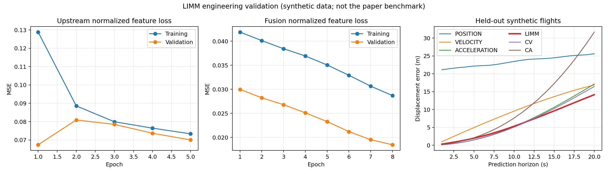

# LIMM 算法复现与小规模验证

2026-11-11；实现位于 [learning/](../../learning/README.md)，
源论文 DOI：10.1016/j.trc.2025.105115。
已实现差分序列、三路 Transformer-LSTM、完整可微分IMM、学习状态/Q/R、
两阶段训练、检查点推理、CSV评估和独立ROS在线预测。
Transformer/LSTM封装可随 `learning/` 独立拆分，无需主仓库ROS源码。

## 完成范围与边界

算法流程已依据正文和图3/4实现，未披露的细节采用显式配置和文档化假设。
未获得作者代码、原始17组完整数据与权重，**未完成论文表2/3的性能复现**。
本报告是工程验证：合成数据上能训练、数值稳定、推理可恢复、在线与离线一致。
不能把下列误差与论文的真实飞行测试数值直接比较。
网络宽度等假设与数值稳定性处理详见 [包说明](../../learning/README.md#算法细节和复现假设)。

## 实验配置

- Python 3.10.12、PyTorch 2.14.1+cpu、NumPy 2.2.6；CPU单线程，种子42。
- 历史40点/未来20点，dt=1秒；P/V/A历史长度40/39/38，窗口步长1。
- 三路Transformer均使用3层编码+3层解码，隐藏32、4头、FFN128、dropout .1，输出LSTM1层。
- LIMM历史编码2层LSTM，每个模式分别拥有fx/fQ/fR LSTMCell；保留完整IMM交互。
- 逐预测步共享的转移logits[20,3,3]；Q/R采用Cholesky参数化，正定协方差。
- AdamW，lr=.001、weight_decay=.001、batch64；每6000步乘.9，本小实验未到衰减点。
- 上游训练5轮，验证最优在第1轮，恢复该权重后冻结；融合训练8轮，最优为第8轮。
- 上游验证MSE最佳0.067364；融合验证MSE从0.029975降到0.018459。
  二者的目标和维数不同，不应直接横向比较损失大小。

生成器使用三轴正弦叠加匀速漂移与0.03米位置噪声。
6条训练、2条验证、3条测试飞行，每条120个点，分别366/122/183个窗口。
测试频率范围相对训练扩大1.5倍，飞行互不重叠；同一飞行中的滑动窗口存在重叠。
仅一个种子、三个测试飞行和少量训练，**不支持统计显著性或泛化优势结论**。
测试真值仅作标签，上游、融合、归一化和在线适配都不使用未来真值。

## 同批测试窗口的结果

| 方法 | ADE (m) | FDE (m) |
| --- | ---: | ---: |
| 位置直接预测 | 23.4437 | 25.5956 |
| 速度预测积分路线 | 9.6099 | 16.8774 |
| 加速度预测积分路线 | 6.7854 | 17.1419 |
| LIMM融合 | **6.3042** | **14.1607** |
| CV | 6.5557 | 16.4556 |
| CA（离散加速度约定） | 11.1778 | 31.6668 |

LIMM在本次小实验中略优于CV及三条上游路线。上游位置路线误差很大，
训练不足且验证最优在首轮；这说明当前权重仅适合流程演示，不能视为充分训练的实际部署模型。
以下图包含全部训练轮次，而评估使用各阶段验证最优权重。

## 实际执行的验证

1. `python -m pytest learning/tests -q`：18项通过，覆盖非单位dt差分边界、
   split-before-window、训练尺度隔离、按样本归一化、三路积分、IMM解析解、Kalman解析解、
   自动微分gradcheck、似然下溢、全部骨干网络梯度、冻结上游、正定性、检查点和两阶段实际训练。
2. `cmake --build build/predictor -j2`：新增位置观测发布器编译成功。
   `ctest --test-dir build/predictor --output-on-failure`：7项现有检查通过。
   初次 `colcon build` 停留在环境准备阶段，已取消；直接CMake构建成功，安装目录可执行文件为该构建的符号链接。
3. 独立 `evaluate` 和 `predict` CLI 成功重载权重；导出未来点CSV。
   全部保存权重逐项精确一致；推理与指标按float32容差比较，允许不同CPU内核路径引起的微小舍入差异。
4. 真实ROS2通信测试：40条仅含位置的观测生成20点Path，验证frame、未来时间戳、
   点数、有限性及与相同历史离线推理的一致性。复验使用独立ROS_DOMAIN_ID=92。
   该检查是合成消息通信测试，没有运行90秒Pangolin整场仿真。
5. 独立包已通过editable安装，`uav-limm --help` 可运行；`git diff --check` 通过。

## 输出与重跑

- [完整配置、来源SHA256、逐轮损失和全部指标](20261111-limm-results.json)
- 本机权重：`outputs/limm_smoke_20261111/model.pt`（保留在工作区，未提交大权重文件）。
- 本机测试预测：`outputs/limm_smoke_20261111/predictions.csv`。
- 重跑命令见 [learning/README.md](../../learning/README.md#快速运行已验证的小实验)，
  对应数据目录为 `outputs/limm_synthetic_20261111`，实验目录为 `outputs/limm_smoke_20261111`。

正式论文对比需准备MavicAir2/Payload的独立飞行时间划分，按论文训练并对15组新域数据评估，
同时用相同划分和充分训练预算重跑Transformer/LSTM基线。
现有ROS集成发布独立的 `/limm/prediction`，未加入C++工厂选项；
原有仿真显示和指标仍属于C++基线，LIMM指标由独立评估命令生成。
